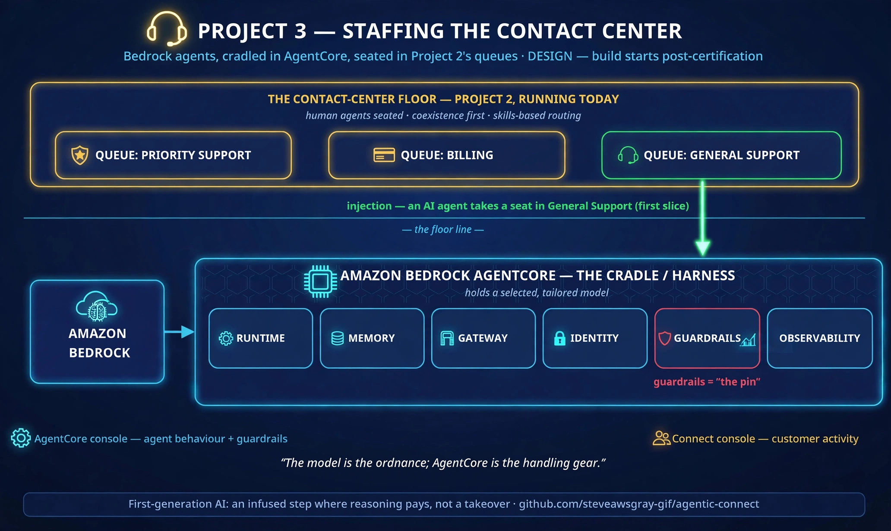
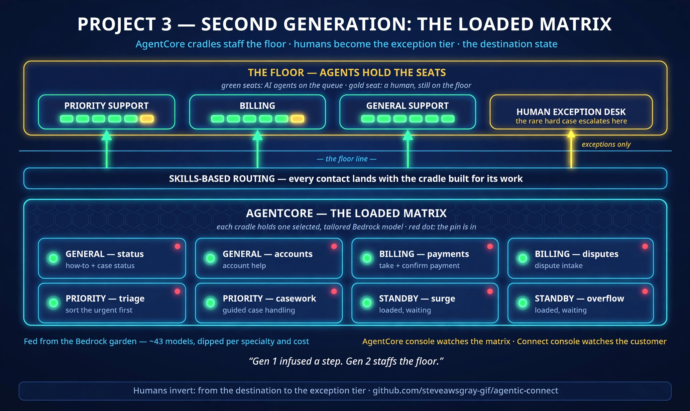

# Agentic Connect

Custom Bedrock agents staffing Amazon Connect queues, with AgentCore
as the control plane.

**Status — 24 Nov 2026:** design briefs published; Gate 0 spike proved
the AgentCore Runtime hosting path fails on auth (403, bearer-only).
Parked — re-host (ECS/App Runner) is the next step.

A system to create and add agentic agents using Bedrock and AgentCore

**Second generation - the destination state:** the loaded matrix staffs the floor, and humans become the exception tier.

## Design brief

[Generation 1 design brief](docs/gen-1-design-brief.md) - one governed agent in General Support: the job, the cradle, the pin, the evaluation gates and the build sequence.

[Generation 2 design brief](docs/gen-2-design-brief.md) - the destination state: a matrix of queue-dedicated pods, autonomy tiers, skills-based routing, and humans as the exception tier.

## How Generation 2 is demonstrated

Generation 2 is shown as a design, not a live call: the complete
[Terraform blueprint](docs/gen-2-terraform-blueprint.md) (written, never
applied), a [console demo](docs/gen-2-console-demo.md) across the Connect
floor view and the AgentCore matrix view, and a
[call-flow walkthrough](docs/gen-2-call-flow-walkthrough.md) of one contact
through the matrix. Live proof is Generation 1's job.
